# Mister Download Manager

<p align="center">
  
</p>

<h3 align="center">Downloads faster than IDM. Free, forever.</h3>

<p align="center">🌐 <a href="https://misterdownloadmanager.com"><b>misterdownloadmanager.com</b></a>: the official website, with the downloads, help and news</p>

<p align="center">
  <a href="https://github.com/anefzaoui/misterdownloadmanager/releases/latest"></a>
  <a href="https://github.com/anefzaoui/misterdownloadmanager/releases/latest"></a>
  <a href="https://github.com/anefzaoui/misterdownloadmanager/releases/latest"></a>
</p>

<p align="center">
  🧩 <b>Browser extension:</b><br>
  <a href="https://addons.mozilla.org/firefox/addon/mister-download-manager/"></a>
  <a href="https://chromewebstore.google.com/detail/mister-download-manager/ejoleppdfgjdndddcjoehopknmlglojp"></a><br>
  <sub>The Chrome Web Store's is for
   Edge,
   Brave,
   Opera, Vivaldi and Helium too (<a href="docs/browser-integration.md">how</a>).</sub>
</p>

<p align="center">
  <a href="https://github.com/anefzaoui/misterdownloadmanager/stargazers"></a><br>
  <sub>⭐ <b>Like it? Give it a star.</b> MDM has no ads and no marketing budget: stars are how people find it.</sub>
</p>

<p align="center">
  Windows 10 and 11 (x64, ARM64, 32-bit) · Linux (Ubuntu, Debian, Mint, Fedora, openSUSE, Arch and more; x86-64 and ARM64) · macOS (Apple Silicon and Intel, experimental)<br>
  86 languages · no ads, no trial, no sign-up
</p>

<table align="center">
  <tr>
    <td align="center" width="210"><h1>5×</h1><b>Faster</b><br><sub>a 1 GB file: 1 s instead of 5.5 s</sub></td>
    <td align="center" width="210"><h1>+46</h1><b>More languages</b><br><sub>86 instead of IDM's 40</sub></td>
    <td align="center" width="210"><h1>100%</h1><b>Cheaper (free!)</b><br><sub>no licence, no trial, ever</sub></td>
    <td align="center" width="210"><h1>Torrent</h1><b>Supported fully</b><br><sub>magnet links, .torrent files, seeding</sub></td>
  </tr>
</table>

<p align="center">
  <picture>
    <source media="(prefers-color-scheme: dark)" srcset="docs/images/main-dark.webp">
    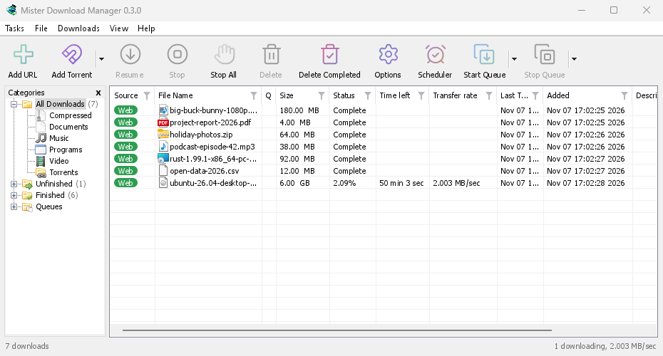
  </picture>
</p>

<p align="center">
  <a href="https://github.com/anefzaoui/misterdownloadmanager/releases/latest"></a>
  <a href="https://github.com/anefzaoui/misterdownloadmanager/releases"></a>
  <a href="https://github.com/anefzaoui/misterdownloadmanager/actions/workflows/ci.yml"></a>
  <a href="https://github.com/anefzaoui/misterdownloadmanager/stargazers"></a>
  <a href="https://addons.mozilla.org/firefox/addon/mister-download-manager/"></a>
  <a href="https://chromewebstore.google.com/detail/mister-download-manager/ejoleppdfgjdndddcjoehopknmlglojp"></a>
  <a href="LICENSE"></a>
</p>

| 🚀 [Download](#download) | ⚡ [Why switch](#why-switch-from-idm) | 🖼️ [Screenshots](#screenshots) | ✨ [Getting started](docs/getting-started.md) | 📜 [Help and tutorials](docs/README.md) |
| --- | --- | --- | --- | --- |

## Why switch from IDM?

**Same window you know. Your downloads finish sooner. And it costs nothing.**

<p align="center">
  <picture>
    <source media="(prefers-color-scheme: dark)" srcset="docs/images/races-dark.svg">
    
  </picture>
</p>

<!-- compare:start -->
| | Mister Download Manager | IDM 6.42 |
| --- | --- | --- |
| Download a big file (1 GB) | **1 second** | 5.5 seconds |
| Download a small file | **instantly** | 3.1 seconds |
| Download over a shaky connection | **1.6 seconds** | 5.4 seconds |
| Wait before a download starts | **instantly** | 3.1 seconds |
| Price | **Free, forever** | Paid, after a 30-day trial |
| Ads, nag screens, sign-up | **None** | Registration needed |
| Open source | **Yes** (GPL) | No |
<!-- compare:end -->

Nothing new to learn: the toolbar, the categories, the list of downloads, the progress window and
the browser button are where you expect them. Measured on the same computer, same files, both
programs at their default settings ([how we measured](#the-benchmark-in-detail)).

## Download

<p align="center">
  <a href="https://github.com/anefzaoui/misterdownloadmanager/releases/latest"></a>
  <a href="https://github.com/anefzaoui/misterdownloadmanager/releases/latest"></a>
  <a href="https://github.com/anefzaoui/misterdownloadmanager/releases/latest"></a>
</p>

On the [download page](https://github.com/anefzaoui/misterdownloadmanager/releases/latest), pick
one:

| File | Choose it when |
| --- | --- |
| **`...-setup.exe`** | **Not sure? Take this one.** It installs MDM, connects it to your browser and asks your language. |
| `...-portable.zip` | You want MDM on a USB stick or without installing: unzip and run. Everything stays in its folder. |
| `...-x64.zip` | You want the plain programs without an installer. |
| `...-setup-arm64.exe`, `...-portable-arm64.zip`, `...-arm64.zip` | The same three for **Windows on ARM** (Snapdragon and other ARM PCs). |
| `...-setup-x86.exe`, `...-portable-x86.zip`, `...-x86.zip` | The same three for **32-bit Windows 10**. There, choose your own ffmpeg in **Helpers** for the best video qualities: none is built for it that MDM can check. |
| `...-extension-chromium.zip` | You want to add the browser extension by hand (Chrome, Edge, Brave, Opera, Vivaldi). From the stores is easier: [Add to Chrome](https://chromewebstore.google.com/detail/mister-download-manager/ejoleppdfgjdndddcjoehopknmlglojp), [Add to Firefox](https://addons.mozilla.org/firefox/addon/mister-download-manager/). |

The ARM64 and 32-bit files come with every release after 0.5.2; **Check for updates** keeps each
copy on its own processor's files.

> [!NOTE]
> Windows may say *"Windows protected your PC"* the first time, because this early version isn't
> code-signed yet. Click **More info**, then **Run anyway**.

Or with [WinGet](https://learn.microsoft.com/windows/package-manager/winget/), Windows' package
manager: in a terminal, the first line installs MDM and the second updates it.

```
winget install AhmedNefzaoui.MisterDownloadManager
winget upgrade AhmedNefzaoui.MisterDownloadManager
```

### On Linux

MDM runs on Linux too, tested on Ubuntu 24.04, Debian 12 and Fedora with GNOME, KDE Plasma, Xfce
and Cinnamon, on X11 and in Wayland sessions: the tray, dark mode, browser integration (Ubuntu's
Snap Firefox included) and the packages' installs. Not there yet: screen readers (Orca) don't
read its windows, and Flatpak browsers can't reach it ([more](docs/getting-started.md#on-linux)).
Up to version 0.2.4, the files' names end in `-experimental`.

| File | For |
| --- | --- |
| `...-linux-x86_64.deb` | Ubuntu, Debian, Mint, Pop!_OS: `sudo apt install ./<file>.deb`. |
| `...-linux-x86_64.rpm` | Fedora, openSUSE, RHEL: `sudo dnf install ./<file>.rpm`. |
| `...-linux-x86_64.AppImage` | Any Linux. Make it executable and run it. |
| `...-linux-x86_64.tar.gz` | The plain programs, for any distribution. |
| `...-linux-arm64.*` | The same four for 64-bit ARM computers, from the release after 0.5.2 (built and tested on GitHub's ARM machines). |

<p align="center">
  <picture>
    <source media="(prefers-color-scheme: dark)" srcset="docs/images/main-linux-dark.webp">
    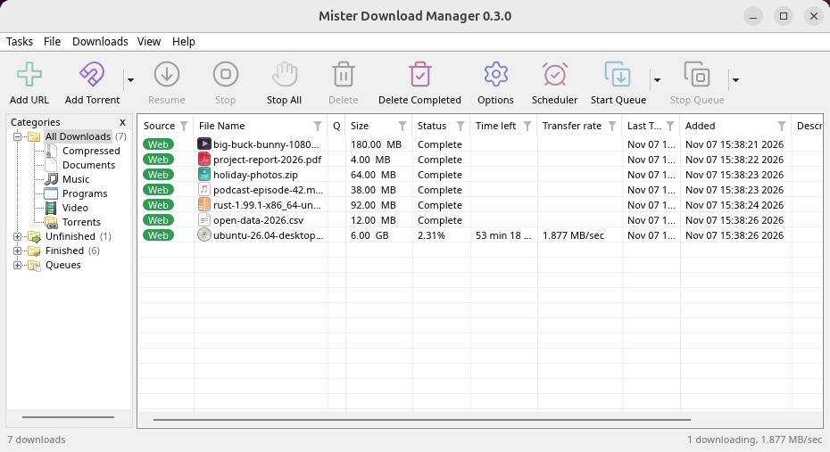
  </picture>
</p>

### On a Mac? Be the first to try it

Fresh builds for **macOS** (Apple Silicon and Intel) are on the same download page, marked
`-experimental`: we haven't tried them on a Mac ourselves yet. Give them a go and
[tell us how it went](https://github.com/anefzaoui/misterdownloadmanager/issues/new/choose); you'll
help make them as solid as the Windows and Linux versions.

| File | For |
| --- | --- |
| `...-macos-arm64-experimental.dmg` | Mac with Apple Silicon (M1 or later). Open it and drag MDM to Applications. The first time, right-click the app and choose **Open**. |
| `...-macos-x86_64-experimental.dmg` | Mac with an Intel processor, the same way. |

## 🌍 In your language

Every language Windows 11 offers, **86 in all**. MDM asks on its first start, and you can change
it any time in **View → Language**. Arabic, Hebrew, Persian, Urdu and Uyghur get a fully mirrored,
right-to-left window.

<!-- languages:start -->
<p align="center">


</p>
<!-- languages:end -->

## Screenshots

<table>
  <tr>
    <td width="50%"><br><sub><b>One click on YouTube</b>: the Download video button appears over the video.</sub></td>
    <td width="50%"><br><sub><b>Any video on any page</b>: drag the button where you like, it stays there.</sub></td>
  </tr>
  <tr>
    <td width="50%">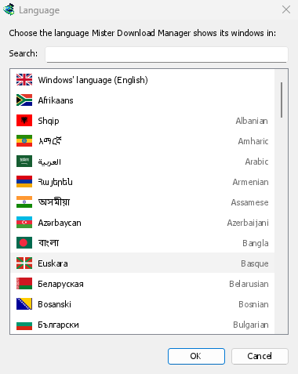<br><sub><b>Watch it fly</b>: every connection's share of the file, live speed and time left.</sub></td>
    <td width="50%">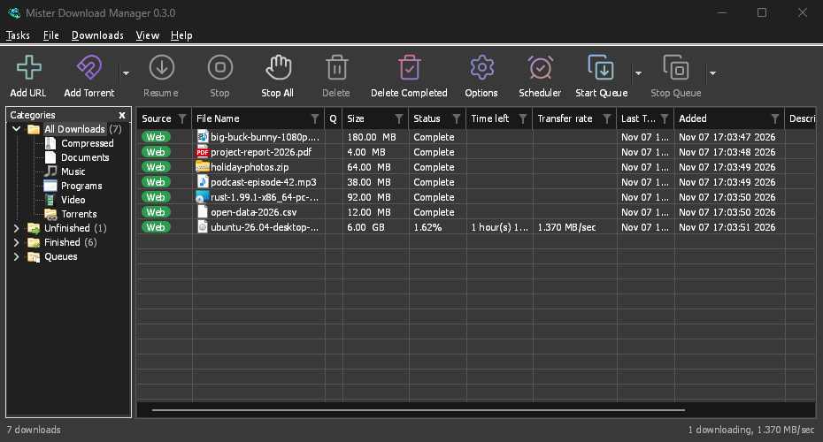<br><sub><b>Dark mode</b> that follows Windows.</sub></td>
  </tr>
  <tr>
    <td>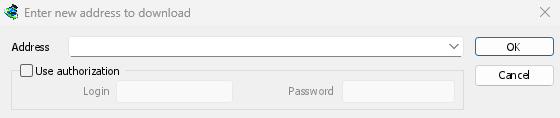<br><sub><b>Add a download</b>: paste a link, or let MDM catch it from your browser.</sub></td>
    <td>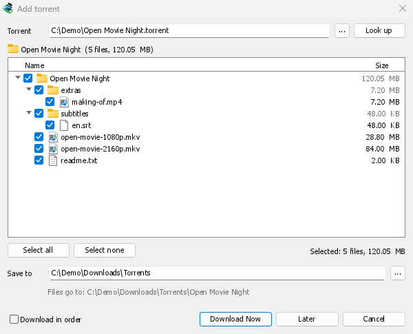<br><sub><b>Torrents and magnet links</b>: pick the files you want, skip the rest.</sub></td>
  </tr>
  <tr>
    <td>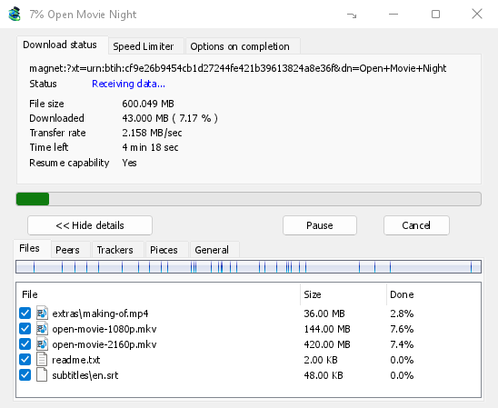<br><sub><b>A torrent's progress</b>: its files, peers, trackers and pieces, in tabs.</sub></td>
    <td>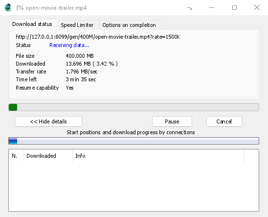<br><sub><b>A video's progress</b>: speed and time left while yt-dlp brings it in.</sub></td>
  </tr>
  <tr>
    <td><br><sub><b>86 languages</b>, chosen by flag on the first start.</sub></td>
    <td>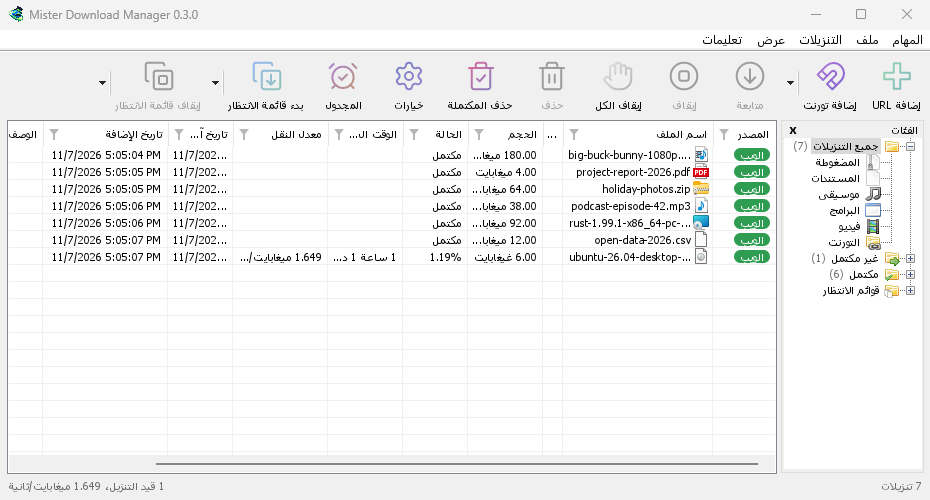<br><sub><b>Right to left</b> for Arabic, Hebrew, Persian, Urdu and Uyghur.</sub></td>
  </tr>
  <tr>
    <td>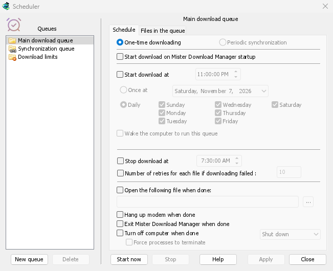<br><sub><b>Download overnight</b>: queues that start and stop on their own.</sub></td>
    <td>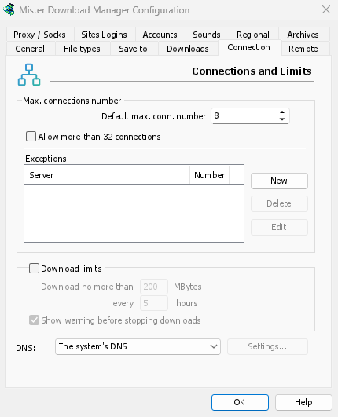<br><sub><b>Options</b> where you expect them, every control working.</sub></td>
  </tr>
</table>

## What it does

- **Speeds up every download** by fetching parts of the file at the same time, and keeps
  re-balancing until the last byte.
- **Resumes** after a crash, a restart or a dropped connection, without starting over.
- **Catches downloads from Firefox, Chrome, Edge, Brave, Opera, Vivaldi and Helium** (the
  extension is on Firefox Add-ons and the Chrome Web Store), and gives them back to the browser
  when MDM isn't running.
- **Downloads videos** from web pages (a button appears over the video; playlists, subtitles,
  the sound alone), **image galleries** with gallery-dl, and **torrents and magnet links**
  (sequential order, RSS feeds, sharing limits).
- **Many links at once**: the Link grabber sorts them into packages and extracts the archives
  (zip, 7z, rar) when they're in. It takes Click'n'Load from link sites, asking once per site. Debrid accounts (Real-Debrid, AllDebrid, Premiumize, TorBox, Mega-Debrid; experimental) download
  file-host links through your own account.
- **Downloads overnight** with queues and a scheduler that can wake the computer, then shuts it
  down if you like.
- **Through your VPN only**, if you want: hold every download to one network adapter, with a kill
  switch, and choose an encrypted DNS. Each download shows its server's country.
- **From your phone, or on a server**: control MDM from a phone on your home network, or run it
  without a window on a NAS (Docker, Unraid) ([how](docs/server.md)).
- **Works from scripts too**: IDM's command-line switches, a command-line tool, and a local API for other programs ([how](docs/command-line.md)).
- **Works with your AI assistant**: an MCP server lets Claude, Cursor or VS Code list, add, pause and remove your downloads ([set it up](docs/ai-assistants.md)).
- **Leaves you some speed**: limit one download or all of them, only while you're at the computer.
- **Day and dark mode, and themes**: Classic, Native, High contrast, Metro, Adwaita, Breeze,
  Luna, Aero and Aqua, or your own in a text file ([how](docs/themes.md)). Everything larger, up
  to 200 %, with **View → Interface size**. 86 languages, and a portable version for USB sticks.
- **Works from the keyboard and with screen readers** (Narrator, NVDA): every window, dialog and
  menu ([the keys](docs/keyboard-shortcuts.md)).
- **No ads, no trial, no account**. Free and open source.

Step by step: [your first download](docs/guide-first-download.md) ·
[catch every browser download](docs/guide-catch-browser-downloads.md) ·
[download overnight](docs/guide-download-overnight.md) ·
[download a video](docs/guide-video-from-page.md) · [all help pages](docs/README.md)

---

## The benchmark in detail

Both programs downloaded the same files from the same local test server
([labserver](crates/labserver)), with the network trouble each scenario names: seven runs each,
both at their default settings. MDM finished first in **all seven scenarios**; every difference is
statistically significant (Mann-Whitney p < 0.001), and MDM used less CPU in every one.

<p align="center">
  <picture>
    <source media="(prefers-color-scheme: dark)" srcset="docs/images/bench-time-dark.svg">
    
  </picture>
</p>

On a server that allows only two connections, MDM used 2 and still finished first; IDM opened 480.
The full table, the machine and the raw data: [docs/bench/run5/REPORT.md](docs/bench/run5/REPORT.md).
The harness is in [tools/bench](tools/bench), so anyone can run it again.

## Not a reverse-engineering project

MDM is an independent, clean-room program. It is a new implementation of a familiar way of
working, not a copy of anyone's software.

- **No one else's code or assets.** It contains no code, binaries, artwork, icons, sounds or
  text from Internet Download Manager, nor code from any other download manager. The app icon
  was made for MDM with ChatGPT (OpenAI's image generation); the other icons come from openly
  licensed sets ([ATTRIBUTION.md](ATTRIBUTION.md)).
- **Nothing taken apart.** No IDM file was ever disassembled, decompiled, debugged, patched or
  inspected below its user interface, and its licensing, trial and registration were never
  touched or bypassed.
- **Learned as a user learns.** What MDM does was learned from IDM's public documentation and
  help pages, its public screenshots, and by using a licensed copy as a black box: downloading
  test files from our own test server ([labserver](crates/labserver)) and watching what reached
  the network and the screen.
- **Built on public standards.** The download engine follows the HTTP specifications (RFC 9110,
  RFC 9112) and was designed, tested and measured independently. Its speed comes from its own
  design, which the benchmark shows.
- **Not affiliated.** MDM isn't affiliated with, endorsed by or connected to Tonec Inc.
  "Internet Download Manager" and "IDM" are trademarks of their owner, named here only to
  describe the layout people already know and to compare the two programs.

## For developers

<details>
<summary><b>Build from source</b></summary>

Requires Rust stable 1.98 or later (the MSVC toolchain on Windows), and for the engine's
browser-like connection (BoringSSL, built from source): CMake, LLVM's libclang and, on Windows,
NASM (`winget install Kitware.CMake LLVM.LLVM NASM.NASM`; on Linux `cmake` and
`libclang-dev`; on macOS Xcode's command line tools and `cmake`).
`cargo build -p mdm-app --no-default-features` builds the app without it (a site that refuses MDM's
own connection then stays refused).

```
cargo build --release
cargo test
```

This makes `misterdownloadmanager.exe` (the app), `misterdownloadmanager-cli.exe` (headless
command line), `misterdownloadmanager-mcp.exe` (the MCP server for AI assistants) and
`misterdownloadmanager-nmhost.exe` (the browser host) in `target\release\`.
`tools\installer\build.ps1` builds the installer and both zips into `target\dist\` (needs
[Inno Setup 6.3](https://jrsoftware.org/isinfo.php) or later), for x64; `-Arch arm64` or
`-Arch x86` for Windows on ARM or 32-bit Windows (after `rustup target add
aarch64-pc-windows-msvc` or `i686-pc-windows-msvc`). `tools/installer/build-linux.sh` builds the
Linux files for the machine's own processor (x86-64 or ARM64). A `vX.Y.Z` tag does all of them
on GitHub Actions and publishes the release.

Browser integration from a build: register the native messaging host with
`target\release\misterdownloadmanager-nmhost.exe --register` (undo with `--unregister`), then in
`chrome://extensions` or `edge://extensions` turn on Developer mode, **Load unpacked** and pick
the `extension/` folder (its ID is always `oogbclbbninliongijffeeggalppliok`).

</details>

<details>
<summary><b>Layout and tools</b></summary>

A Cargo workspace (edition 2024); [docs/ARCHITECTURE.md](docs/ARCHITECTURE.md) explains how the
pieces fit.

| Crate | What it is |
|---|---|
| [`mdm-engine`](crates/engine) | The download engine: segmentation, connections, resume, limits |
| [`mdm-app`](crates/app) | The desktop app (egui), and `--headless` for servers |
| [`mdm-cli`](crates/cli) | Headless downloads from the command line |
| [`mdm-mcp`](crates/mcp) | The MCP server, for AI assistants |
| [`mdm-nmhost`](crates/nmhost) | The browser's native messaging host |
| [`mdm-ipc`](crates/ipc) | Talking to a running app; shared capture rules; the extension's IDs |
| [`mdm-remote`](crates/remote) | The remote control: the HTTPS server and page a paired phone uses |
| [`mdm-crash`](crates/crash) | Crash and freeze reports: the monitor, minidumps, stacks |
| [`mdm-debrid`](crates/debrid) | Debrid accounts through the services' official APIs |
| [`mdm-extract`](crates/extract) | Archive extraction (zip, tar, gz, xz; 7z and RAR through 7-Zip; in place through HatchZip) |
| [`mdm-geo`](crates/geo) | A server's country, from an IP table on this computer |
| [`mdm-tools`](crates/tools) | yt-dlp and ffmpeg for video pages, gallery-dl for galleries |
| [`mdm-torrent`](crates/torrent) | BitTorrent through librqbit |
| [`mdm-labserver`](crates/labserver) | An HTTP test server with fault injection, for tests and benchmarks |

| Tool | What it does |
|---|---|
| `tools\dev\check-cross.ps1` | Checks the code for Linux and macOS from Windows (with [Zig](https://ziglang.org) as the C compiler) |
| `node tools/extension/e2e.mjs` | The browser extension in real Chrome, Brave, Edge and Firefox, headless: a link's download must reach MDM (or another MDM, a server); on Windows and Linux |
| `python tools/i18n/extract.py` | Lists every interface text in `i18n/en.tsv` (CI checks it matches the code) |
| `python tools/i18n/translate.py` | Translates what the catalogs lack (checks every row in code) |
| `python tools/installer/languages.py` | The installer's messages in every language |
| `node tools/readme/build.mjs` | This page's pictures, comparison table and flags, from the benchmark data |
| `tools\lab\docs-shots.ps1` | The screenshots, from a separate test instance (`/show <window>` opens each window), off the screen |
| `python tools/shots/make.py` | The help pages' pictures, from one list (`tools/shots/shots.toml`): shot, cropped, annotated, lossless WebP; `make.py check` keeps them in step |
| `tools/lab/wsl/` | A WSL2 machine that builds MDM for Linux in minutes and shoots its windows on a virtual screen ([README](tools/lab/wsl/README.md)) |
| `tools\lab\progress-shots.ps1` | The progress window of a video (yt-dlp) and of a torrent, from a swarm on this computer (`cargo run -p mdm-torrent --example swarm`) |
| `python tools/website/build.py --serve` | misterdownloadmanager.com into `target/site` (help pages from `docs/`, news from the CHANGELOG, FAQ and legal pages from `website/content/`), served on http://127.0.0.1:8765; GitHub Pages publishes it (`pages.yml`) |
| `python tools/readme/social.py` | The repository's social preview card (`docs/images/social-preview.png`) |
| `MDM_FIT_AUDIT=<file>` | Lists every text that doesn't fit its window or runs over another, for checking a translation |
| `MDM_OFFSCREEN=1` | Opens every window off the screen, without focus, tray icon or sound (screenshots and checks) |
| `MDM_TEST_TRASH_DIR=<folder>` | Tests only: archives deleted after extracting go into this folder, never into the real Recycle Bin or Trash |
| `MDM_TEST_7ZIP=<program>\|none` | Tests only: the 7-Zip program to use for 7z and RAR archives, or `none` to act as if 7-Zip weren't installed |
| `MDM_TEST_HATCHZIP=<program>\|none` | Tests only: the HatchZip program to use (extraction in place), or `none` to act as if HatchZip weren't installed |

</details>

## Status and helping out

MDM is young: the engine, the main window and the browser integration are solid on Windows and
Linux, and some corners are still "good enough for now".

- **Translations are machine-made.** Rows marked `#, machine` in [`i18n/`](i18n) wait for a
  native speaker; fixing one is a one-line pull request ([how](docs/languages.md)). Malay's
  menus, toolbar and download-list columns have been reviewed by a native speaker.
- Not yet: code signing. The macOS builds are untested; on Linux, screen readers (Orca) and
  Flatpak browsers aren't supported yet.

Bug reports are welcome in
[Issues](https://github.com/anefzaoui/misterdownloadmanager/issues/new/choose): **Help → Report a problem**
in the app fills in your version and system. Ideas are welcome in
[Discussions](https://github.com/anefzaoui/misterdownloadmanager/discussions/categories/ideas). Pull requests are accepted under the same licence: start with [CONTRIBUTING.md](CONTRIBUTING.md).

## Made possible by these amazing humans

Everyone who sent a pull request, opened an issue or joined a conversation here: thank you. People
with pull requests first, then issues, then comments; [the website](https://misterdownloadmanager.com/contributors.html)
shows what each one did.

<!-- contributors:start (python tools/contributors.py readme) -->
<p>
<a href="https://github.com/riyazalsodie" title="riyazalsodie"></a>
<a href="https://github.com/Seyamalam" title="Seyamalam"></a>
<a href="https://github.com/AzureKnigh7" title="AzureKnigh7"></a>
<a href="https://github.com/awishtodiexz" title="awishtodiexz"></a>
<a href="https://github.com/perfhelf" title="perfhelf"></a>
<a href="https://github.com/arifrhm" title="arifrhm"></a>
<a href="https://github.com/9M2PJU" title="9M2PJU"></a>
<a href="https://github.com/Raghav2012Code" title="Raghav2012Code"></a>
<a href="https://github.com/Kyusetzu" title="Kyusetzu"></a>
<a href="https://github.com/Vhierly" title="Vhierly"></a>
<a href="https://github.com/abdul-karim-mia" title="abdul-karim-mia"></a>
<a href="https://github.com/geniusmonir" title="geniusmonir"></a>
<a href="https://github.com/atishay-kasliwal" title="atishay-kasliwal"></a>
<a href="https://github.com/LiemFrans" title="LiemFrans"></a>
<a href="https://github.com/aniyow07" title="aniyow07"></a>
<a href="https://github.com/mhsenam" title="mhsenam"></a>
<a href="https://github.com/mayankmohan1992" title="mayankmohan1992"></a>
<a href="https://github.com/notnooob" title="notnooob"></a>
<a href="https://github.com/yabtesfu" title="yabtesfu"></a>
<a href="https://github.com/atomus121" title="atomus121"></a>
<a href="https://github.com/joyahmed" title="joyahmed"></a>
<a href="https://github.com/its-benjamin" title="its-benjamin"></a>
<a href="https://github.com/specailm5" title="specailm5"></a>
<a href="https://github.com/pepitopro123123" title="pepitopro123123"></a>
<a href="https://github.com/JuanF007" title="JuanF007"></a>
<a href="https://github.com/PiyushChoudhary-Git" title="PiyushChoudhary-Git"></a>
<a href="https://github.com/Emotion04" title="Emotion04"></a>
<a href="https://github.com/HUISDE" title="HUISDE"></a>
<a href="https://github.com/Marobotic" title="Marobotic"></a>
<a href="https://github.com/pavan-98" title="pavan-98"></a>
<a href="https://github.com/Totopo27" title="Totopo27"></a>
<a href="https://github.com/joeabouserhal" title="joeabouserhal"></a>
<a href="https://github.com/mhmdeve" title="mhmdeve"></a>
<a href="https://github.com/TG-Twilight" title="TG-Twilight"></a>
<a href="https://github.com/ahammedzihadkhan" title="ahammedzihadkhan"></a>
<a href="https://github.com/DehPython" title="DehPython"></a>
<a href="https://github.com/ggaoph-lab" title="ggaoph-lab"></a>
<a href="https://github.com/i1Zeus" title="i1Zeus"></a>
<a href="https://github.com/IMDSFULL" title="IMDSFULL"></a>
<a href="https://github.com/Jalawoud" title="Jalawoud"></a>
<a href="https://github.com/michael3528525855" title="michael3528525855"></a>
<a href="https://github.com/purnadika" title="purnadika"></a>
<a href="https://github.com/Rayiumir" title="Rayiumir"></a>
<a href="https://github.com/rioovs" title="rioovs"></a>
<a href="https://github.com/RuiNelson" title="RuiNelson"></a>
<a href="https://github.com/shaikhnedab" title="shaikhnedab"></a>
<a href="https://github.com/ShammiSandaruwan" title="ShammiSandaruwan"></a>
<a href="https://github.com/SinaYousefian" title="SinaYousefian">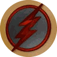</a>
<a href="https://github.com/sudoevolve" title="sudoevolve"></a>
<a href="https://github.com/void-lawliet" title="void-lawliet"></a>
<a href="https://github.com/wcxu21" title="wcxu21"></a>
<a href="https://github.com/wohusaixing" title="wohusaixing"></a>
<a href="https://github.com/azizr12" title="azizr12"></a>
<a href="https://github.com/RoesRezk" title="RoesRezk"></a>
<a href="https://github.com/alshedupur" title="alshedupur"></a>
<a href="https://github.com/christubuntu" title="christubuntu"></a>
<a href="https://github.com/osunday" title="osunday"></a>
<a href="https://github.com/iamthelara" title="iamthelara"></a>
<a href="https://github.com/phamgiahung1368" title="phamgiahung1368"></a>
<a href="https://github.com/Stark-0505" title="Stark-0505"></a>
<a href="https://github.com/finnuen" title="finnuen"></a>
<a href="https://github.com/majidataei-dev" title="majidataei-dev"></a>
<a href="https://github.com/dop3klo" title="dop3klo"></a>
<a href="https://github.com/sanayaima" title="sanayaima"></a>
<a href="https://github.com/StevieApp" title="StevieApp"></a>
<a href="https://github.com/DEEP-PEMN" title="DEEP-PEMN"></a>
<a href="https://github.com/eduardomozart" title="eduardomozart"></a>
<a href="https://github.com/jimmyoffa" title="jimmyoffa"></a>
<a href="https://github.com/kakojin-netizen" title="kakojin-netizen"></a>
<a href="https://github.com/SwiftyPop" title="SwiftyPop"></a>
<a href="https://github.com/yfor88527" title="yfor88527"></a>
<a href="https://github.com/aanasik" title="aanasik"></a>
<a href="https://github.com/shreeramncity" title="shreeramncity"></a>
<a href="https://github.com/HusneMubarak" title="HusneMubarak"></a>
<a href="https://github.com/JohnyCore" title="JohnyCore"></a>
<a href="https://github.com/SiamakM64" title="SiamakM64"></a>
<a href="https://github.com/ido-png" title="ido-png"></a>
<a href="https://github.com/Unknow995-sys" title="Unknow995-sys"></a>
<a href="https://github.com/ami-hp" title="ami-hp"></a>
<a href="https://github.com/borkarsachin97" title="borkarsachin97"></a>
<a href="https://github.com/Haulien" title="Haulien"></a>
<a href="https://github.com/illuminati2412" title="illuminati2412"></a>
<a href="https://github.com/Nirob3" title="Nirob3"></a>
<a href="https://github.com/Twig6943" title="Twig6943"></a>
<a href="https://github.com/yura0148" title="yura0148"></a>
<a href="https://github.com/Darknight92228" title="Darknight92228"></a>
<a href="https://github.com/Ever4engel" title="Ever4engel"></a>
<a href="https://github.com/fasempertegui" title="fasempertegui"></a>
<a href="https://github.com/gabri25ele" title="gabri25ele"></a>
<a href="https://github.com/husnainahmedrana" title="husnainahmedrana"></a>
<a href="https://github.com/JR13334" title="JR13334"></a>
<a href="https://github.com/Koaxz" title="Koaxz"></a>
<a href="https://github.com/LibyaSat" title="LibyaSat"></a>
<a href="https://github.com/lutfor183" title="lutfor183"></a>
<a href="https://github.com/osvalfortunato" title="osvalfortunato"></a>
<a href="https://github.com/rampageX" title="rampageX"></a>
<a href="https://github.com/sannye12345-crypto" title="sannye12345-crypto"></a>
<a href="https://github.com/vkhir1986-eng" title="vkhir1986-eng"></a>
<a href="https://github.com/Zeeshan1945" title="Zeeshan1945"></a>
<a href="https://github.com/Anurag69og" title="Anurag69og"></a>
<a href="https://github.com/dr-strange15" title="dr-strange15"></a>
<a href="https://github.com/LRamony" title="LRamony"></a>
<a href="https://github.com/engproali" title="engproali"></a>
<a href="https://github.com/keyang556" title="keyang556"></a>
<a href="https://github.com/amiaoapp" title="amiaoapp"></a>
<a href="https://github.com/chiawee" title="chiawee"></a>
<a href="https://github.com/codewithkhushal" title="codewithkhushal"></a>
<a href="https://github.com/daenerys-05" title="daenerys-05"></a>
<a href="https://github.com/Falambons" title="Falambons"></a>
<a href="https://github.com/gvmxo" title="gvmxo"></a>
<a href="https://github.com/JoaoGabriell1" title="JoaoGabriell1"></a>
<a href="https://github.com/mfat" title="mfat"></a>
<a href="https://github.com/praveenkumar2K06" title="praveenkumar2K06"></a>
<a href="https://github.com/rhshourav" title="rhshourav"></a>
<a href="https://github.com/superflyin" title="superflyin"></a>
<a href="https://github.com/20210717" title="20210717"></a>
<a href="https://github.com/97668589" title="97668589"></a>
<a href="https://github.com/aantamimmaarif" title="aantamimmaarif"></a>
<a href="https://github.com/abdullahashraf1141" title="abdullahashraf1141"></a>
<a href="https://github.com/ADNM0" title="ADNM0"></a>
<a href="https://github.com/agagaslol123haha" title="agagaslol123haha"></a>
<a href="https://github.com/bilals2008" title="bilals2008"></a>
<a href="https://github.com/Broo37" title="Broo37"></a>
<a href="https://github.com/Cobra11Murderer" title="Cobra11Murderer"></a>
<a href="https://github.com/deactivated0" title="deactivated0"></a>
<a href="https://github.com/Enzo1383" title="Enzo1383"></a>
<a href="https://github.com/ErrorZeros" title="ErrorZeros"></a>
<a href="https://github.com/erysngl" title="erysngl"></a>
<a href="https://github.com/gorguyoda" title="gorguyoda"></a>
<a href="https://github.com/hellotiansky" title="hellotiansky"></a>
<a href="https://github.com/hexagon07" title="hexagon07"></a>
<a href="https://github.com/KrrishSodho" title="KrrishSodho"></a>
<a href="https://github.com/MagicNetTouch" title="MagicNetTouch"></a>
<a href="https://github.com/mansurctg2005-bit" title="mansurctg2005-bit"></a>
<a href="https://github.com/masudscloud" title="masudscloud"></a>
<a href="https://github.com/medisettivamsikrishna" title="medisettivamsikrishna"></a>
<a href="https://github.com/medtif" title="medtif"></a>
<a href="https://github.com/mehboob-dev" title="mehboob-dev"></a>
<a href="https://github.com/Pumudu820" title="Pumudu820"></a>
<a href="https://github.com/quartzdoll" title="quartzdoll"></a>
<a href="https://github.com/2011navmansh" title="2011navmansh"></a>
<a href="https://github.com/ADIxxDEV" title="ADIxxDEV"></a>
<a href="https://github.com/apoklyps3" title="apoklyps3"></a>
<a href="https://github.com/atifjubaer" title="atifjubaer"></a>
<a href="https://github.com/AwesomeIronman" title="AwesomeIronman"></a>
<a href="https://github.com/bambungs22" title="bambungs22"></a>
<a href="https://github.com/BariSkrktk" title="BariSkrktk"></a>
<a href="https://github.com/bwoah-md" title="bwoah-md"></a>
<a href="https://github.com/CandyAP" title="CandyAP"></a>
<a href="https://github.com/dexnis-dev" title="dexnis-dev"></a>
<a href="https://github.com/dharmikeagle" title="dharmikeagle"></a>
<a href="https://github.com/dotcom3131" title="dotcom3131"></a>
<a href="https://github.com/DrSaeedHub" title="DrSaeedHub"></a>
<a href="https://github.com/elric274" title="elric274"></a>
<a href="https://github.com/enricoottavoita" title="enricoottavoita"></a>
<a href="https://github.com/faisalhafidi" title="faisalhafidi"></a>
<a href="https://github.com/Fonikku" title="Fonikku"></a>
<a href="https://github.com/FxxMorgan" title="FxxMorgan"></a>
<a href="https://github.com/GamingFrazix" title="GamingFrazix"></a>
<a href="https://github.com/hasnain-ali123" title="hasnain-ali123"></a>
<a href="https://github.com/HenryPorternew" title="HenryPorternew"></a>
<a href="https://github.com/joiniran" title="joiniran"></a>
<a href="https://github.com/kalpeshe1m17-creator" title="kalpeshe1m17-creator"></a>
<a href="https://github.com/lakhdar0715" title="lakhdar0715"></a>
<a href="https://github.com/M-Essa11" title="M-Essa11"></a>
<a href="https://github.com/M2Nprime" title="M2Nprime"></a>
<a href="https://github.com/Majid0X-CGDark" title="Majid0X-CGDark"></a>
<a href="https://github.com/Maldo-0750" title="Maldo-0750"></a>
<a href="https://github.com/manish10079" title="manish10079"></a>
<a href="https://github.com/masudur8845" title="masudur8845"></a>
<a href="https://github.com/mcwill54" title="mcwill54"></a>
<a href="https://github.com/monkeynuity" title="monkeynuity"></a>
<a href="https://github.com/Mpsp4321" title="Mpsp4321"></a>
<a href="https://github.com/n4der-er" title="n4der-er"></a>
<a href="https://github.com/randika32-SL" title="randika32-SL"></a>
<a href="https://github.com/resu789" title="resu789"></a>
<a href="https://github.com/ridwan2005ahmed" title="ridwan2005ahmed"></a>
<a href="https://github.com/RomanMV" title="RomanMV"></a>
<a href="https://github.com/rp1989" title="rp1989"></a>
<a href="https://github.com/ryzenx3hack-lgtm" title="ryzenx3hack-lgtm"></a>
<a href="https://github.com/Sallab" title="Sallab"></a>
<a href="https://github.com/shawn8888" title="shawn8888"></a>
<a href="https://github.com/SHURmanizer" title="SHURmanizer"></a>
<a href="https://github.com/skyebuildstheworld" title="skyebuildstheworld">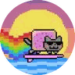</a>
<a href="https://github.com/Skynet19972029" title="Skynet19972029">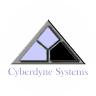</a>
<a href="https://github.com/SoDebug" title="SoDebug"></a>
<a href="https://github.com/sonichy" title="sonichy"></a>
<a href="https://github.com/spamkenny02" title="spamkenny02"></a>
<a href="https://github.com/Speedowagoon58" title="Speedowagoon58"></a>
<a href="https://github.com/TiDS7" title="TiDS7"></a>
<a href="https://github.com/tofighi" title="tofighi"></a>
<a href="https://github.com/toomanyitem" title="toomanyitem"></a>
<a href="https://github.com/vikingcabin" title="vikingcabin">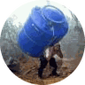</a>
<a href="https://github.com/wxy0626" title="wxy0626"></a>
<a href="https://github.com/wyndon" title="wyndon"></a>
<a href="https://github.com/xd-mau5" title="xd-mau5"></a>
<a href="https://github.com/zelasar-rmd" title="zelasar-rmd"></a>
<a href="https://github.com/5customsgames" title="5customsgames"></a>
<a href="https://github.com/A-F-Rashidi" title="A-F-Rashidi"></a>
<a href="https://github.com/Aayu1254" title="Aayu1254"></a>
<a href="https://github.com/abanoub-ewida" title="abanoub-ewida"></a>
<a href="https://github.com/abdelmalekramoul" title="abdelmalekramoul"></a>
<a href="https://github.com/abderrahmane-707" title="abderrahmane-707">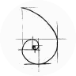</a>
<a href="https://github.com/adamanderson3330" title="adamanderson3330"></a>
<a href="https://github.com/Adiversion" title="Adiversion"></a>
<a href="https://github.com/aeacide" title="aeacide"></a>
<a href="https://github.com/ahfyjdq" title="ahfyjdq"></a>
<a href="https://github.com/AhmadRazaSiddiqi" title="AhmadRazaSiddiqi"></a>
<a href="https://github.com/Ahnaf-Faiyad" title="Ahnaf-Faiyad"></a>
<a href="https://github.com/AiurArtanis" title="AiurArtanis"></a>
<a href="https://github.com/ajmalhashimi002-gif" title="ajmalhashimi002-gif"></a>
<a href="https://github.com/Akhan009" title="Akhan009"></a>
<a href="https://github.com/Alexandre1BR" title="Alexandre1BR"></a>
<a href="https://github.com/alifkarantj" title="alifkarantj"></a>
<a href="https://github.com/amirbahalegharn" title="amirbahalegharn"></a>
<a href="https://github.com/amitabhamistri10" title="amitabhamistri10"></a>
<a href="https://github.com/Antoon2040" title="Antoon2040"></a>
<a href="https://github.com/Arashiaga" title="Arashiaga"></a>
<a href="https://github.com/Ashaxer" title="Ashaxer"></a>
<a href="https://github.com/asherayub" title="asherayub"></a>
<a href="https://github.com/asifbaburcopy-a11y" title="asifbaburcopy-a11y"></a>
<a href="https://github.com/asukaminato0721" title="asukaminato0721"></a>
<a href="https://github.com/biligala" title="biligala"></a>
<a href="https://github.com/blazejwiecha" title="blazejwiecha"></a>
<a href="https://github.com/braininking" title="braininking"></a>
<a href="https://github.com/Bug-Cache" title="Bug-Cache"></a>
<a href="https://github.com/cahsobo" title="cahsobo"></a>
<a href="https://github.com/cammiealar" title="cammiealar"></a>
<a href="https://github.com/chintu79" title="chintu79"></a>
<a href="https://github.com/codewithmahafuj" title="codewithmahafuj"></a>
<a href="https://github.com/cricogo" title="cricogo"></a>
<a href="https://github.com/crse" title="crse"></a>
<a href="https://github.com/CyberLynx007" title="CyberLynx007"></a>
<a href="https://github.com/Darkstar004" title="Darkstar004"></a>
<a href="https://github.com/DavidOsipov" title="DavidOsipov"></a>
<a href="https://github.com/DeAdP00L5" title="DeAdP00L5"></a>
<a href="https://github.com/dhrubo11" title="dhrubo11"></a>
<a href="https://github.com/dmlipat" title="dmlipat"></a>
<a href="https://github.com/Drigva" title="Drigva"></a>
<a href="https://github.com/drpshtiwan" title="drpshtiwan"></a>
<a href="https://github.com/Dued12" title="Dued12"></a>
<a href="https://github.com/eabdalsalam2000-blip" title="eabdalsalam2000-blip"></a>
<a href="https://github.com/Eishawo" title="Eishawo"></a>
<a href="https://github.com/ElolSalm1" title="ElolSalm1"></a>
<a href="https://github.com/EnderDobra" title="EnderDobra"></a>
<a href="https://github.com/estranhosidade" title="estranhosidade"></a>
<a href="https://github.com/ExoticGamer" title="ExoticGamer"></a>
<a href="https://github.com/F50Ci37Y" title="F50Ci37Y">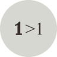</a>
<a href="https://github.com/faisal6309" title="faisal6309"></a>
<a href="https://github.com/faraz152" title="faraz152"></a>
<a href="https://github.com/farhmadi" title="farhmadi"></a>
<a href="https://github.com/farjanatech" title="farjanatech"></a>
<a href="https://github.com/FrozenStoneCamper" title="FrozenStoneCamper"></a>
<a href="https://github.com/furkankolsuz" title="furkankolsuz"></a>
<a href="https://github.com/gevin456" title="gevin456"></a>
<a href="https://github.com/ginDoki19" title="ginDoki19"></a>
<a href="https://github.com/gmq1990" title="gmq1990"></a>
<a href="https://github.com/gowzee" title="gowzee"></a>
<a href="https://github.com/gvpnm" title="gvpnm"></a>
<a href="https://github.com/hakaidocan" title="hakaidocan"></a>
<a href="https://github.com/HalimaBejaoui" title="HalimaBejaoui"></a>
<a href="https://github.com/Hanif-afzal" title="Hanif-afzal"></a>
<a href="https://github.com/harshmandan" title="harshmandan"></a>
<a href="https://github.com/hasan1429" title="hasan1429"></a>
<a href="https://github.com/HaysamSalik" title="HaysamSalik"></a>
<a href="https://github.com/hhmaxman-max" title="hhmaxman-max"></a>
<a href="https://github.com/Hitsuji-mememe" title="Hitsuji-mememe"></a>
<a href="https://github.com/HoochieMamma72" title="HoochieMamma72"></a>
<a href="https://github.com/Hub-ChenSir" title="Hub-ChenSir"></a>
<a href="https://github.com/ibraimfarag" title="ibraimfarag"></a>
<a href="https://github.com/idnetmyid" title="idnetmyid"></a>
<a href="https://github.com/ijaz-at-studio93" title="ijaz-at-studio93"></a>
<a href="https://github.com/ilyasine" title="ilyasine"></a>
<a href="https://github.com/iyousif" title="iyousif"></a>
<a href="https://github.com/jantoek" title="jantoek"></a>
<a href="https://github.com/javanicus-dot" title="javanicus-dot"></a>
<a href="https://github.com/jiarafin01-code" title="jiarafin01-code"></a>
<a href="https://github.com/JoelBj21" title="JoelBj21"></a>
<a href="https://github.com/Jordan-Haidee" title="Jordan-Haidee"></a>
<a href="https://github.com/juanamtanner4" title="juanamtanner4"></a>
<a href="https://github.com/jude-fernandes" title="jude-fernandes"></a>
<a href="https://github.com/junioriqfar" title="junioriqfar"></a>
<a href="https://github.com/justnxhom" title="justnxhom"></a>
<a href="https://github.com/Kakarotto22" title="Kakarotto22"></a>
<a href="https://github.com/kemerous" title="kemerous"></a>
<a href="https://github.com/lawlightxx" title="lawlightxx"></a>
<a href="https://github.com/Lee-mar-Arcon" title="Lee-mar-Arcon"></a>
<a href="https://github.com/lemonspitz" title="lemonspitz"></a>
<a href="https://github.com/Lentzeris" title="Lentzeris"></a>
<a href="https://github.com/LeoAsh6" title="LeoAsh6"></a>
<a href="https://github.com/leonsk29" title="leonsk29"></a>
<a href="https://github.com/lesmealdegunlopezrodriguez-gif" title="lesmealdegunlopezrodriguez-gif"></a>
<a href="https://github.com/li-fcb1899" title="li-fcb1899"></a>
<a href="https://github.com/LNPANDY" title="LNPANDY"></a>
<a href="https://github.com/LoneFaizaan" title="LoneFaizaan"></a>
<a href="https://github.com/lonely2100" title="lonely2100"></a>
<a href="https://github.com/longXaoBai" title="longXaoBai"></a>
<a href="https://github.com/luancabj" title="luancabj"></a>
<a href="https://github.com/LurnEath" title="LurnEath"></a>
<a href="https://github.com/Lyceu" title="Lyceu"></a>
<a href="https://github.com/m4s007" title="m4s007"></a>
<a href="https://github.com/Mahdirahm4ni" title="Mahdirahm4ni"></a>
<a href="https://github.com/MalikSabahatAli" title="MalikSabahatAli"></a>
<a href="https://github.com/manzarehassin" title="manzarehassin"></a>
<a href="https://github.com/marcelofrau" title="marcelofrau"></a>
<a href="https://github.com/marphy12" title="marphy12"></a>
<a href="https://github.com/med771868-star" title="med771868-star"></a>
<a href="https://github.com/MehediHasannOvi" title="MehediHasannOvi"></a>
<a href="https://github.com/menghong-heng" title="menghong-heng"></a>
<a href="https://github.com/merrthereboy" title="merrthereboy"></a>
<a href="https://github.com/miezlearning" title="miezlearning">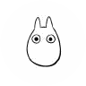</a>
<a href="https://github.com/MightyLord95" title="MightyLord95"></a>
<a href="https://github.com/miladhatami64-beep" title="miladhatami64-beep"></a>
<a href="https://github.com/mkanbar" title="mkanbar"></a>
<a href="https://github.com/mleon55-dev" title="mleon55-dev"></a>
<a href="https://github.com/mockjack3-ui" title="mockjack3-ui"></a>
<a href="https://github.com/MOHAMED19OS" title="MOHAMED19OS"></a>
<a href="https://github.com/Moraphelious" title="Moraphelious"></a>
<a href="https://github.com/movfarid" title="movfarid"></a>
<a href="https://github.com/Mr-Wasique" title="Mr-Wasique"></a>
<a href="https://github.com/mraztrea" title="mraztrea"></a>
<a href="https://github.com/MrRahiar" title="MrRahiar"></a>
<a href="https://github.com/nabilensart" title="nabilensart"></a>
<a href="https://github.com/Nahtan03" title="Nahtan03"></a>
<a href="https://github.com/Namiz4n" title="Namiz4n"></a>
<a href="https://github.com/nant99" title="nant99"></a>
<a href="https://github.com/NeneInfo" title="NeneInfo"></a>
<a href="https://github.com/nezumiXIV" title="nezumiXIV"></a>
<a href="https://github.com/nighter000" title="nighter000"></a>
<a href="https://github.com/NiloyBroForce" title="NiloyBroForce"></a>
<a href="https://github.com/NY48X" title="NY48X"></a>
<a href="https://github.com/osman444dem" title="osman444dem"></a>
<a href="https://github.com/pangty06116" title="pangty06116"></a>
<a href="https://github.com/PANTHEON-Abydos" title="PANTHEON-Abydos"></a>
<a href="https://github.com/payman-neo" title="payman-neo"></a>
<a href="https://github.com/Pechpech84" title="Pechpech84"></a>
<a href="https://github.com/Petershaker3" title="Petershaker3"></a>
<a href="https://github.com/pfmguz" title="pfmguz"></a>
<a href="https://github.com/phidelis30" title="phidelis30"></a>
<a href="https://github.com/phucphanthiet" title="phucphanthiet"></a>
<a href="https://github.com/pishguy" title="pishguy"></a>
<a href="https://github.com/ppiko2981-lang" title="ppiko2981-lang"></a>
<a href="https://github.com/prafullss" title="prafullss"></a>
<a href="https://github.com/Pranav-Game-Dev" title="Pranav-Game-Dev"></a>
<a href="https://github.com/pricisTrail" title="pricisTrail"></a>
<a href="https://github.com/PumpkinJui" title="PumpkinJui">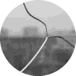</a>
<a href="https://github.com/qaza-umri-app" title="qaza-umri-app"></a>
<a href="https://github.com/ra9fael" title="ra9fael"></a>
<a href="https://github.com/rafaelyokota" title="rafaelyokota"></a>
<a href="https://github.com/rafyessam40-hue" title="rafyessam40-hue"></a>
<a href="https://github.com/Rahmadkurn15" title="Rahmadkurn15"></a>
<a href="https://github.com/Rahul24Now" title="Rahul24Now"></a>
<a href="https://github.com/Ramim18" title="Ramim18"></a>
<a href="https://github.com/RAPER200X" title="RAPER200X"></a>
<a href="https://github.com/rclaptop108" title="rclaptop108"></a>
<a href="https://github.com/Rekcah97" title="Rekcah97"></a>
<a href="https://github.com/sadatdaniel" title="sadatdaniel"></a>
<a href="https://github.com/samipshresthaq" title="samipshresthaq"></a>
<a href="https://github.com/Sayed-Sardar" title="Sayed-Sardar"></a>
<a href="https://github.com/scorpions" title="scorpions"></a>
<a href="https://github.com/Shaandil" title="Shaandil"></a>
<a href="https://github.com/shanhaishi" title="shanhaishi"></a>
<a href="https://github.com/Shirwatel" title="Shirwatel"></a>
<a href="https://github.com/shovoarfin2007-cmd" title="shovoarfin2007-cmd"></a>
<a href="https://github.com/shukiranone-png" title="shukiranone-png"></a>
<a href="https://github.com/SkewelVsAll" title="SkewelVsAll"></a>
<a href="https://github.com/Slicknh0" title="Slicknh0"></a>
<a href="https://github.com/smsmforme2030" title="smsmforme2030"></a>
<a href="https://github.com/specurial" title="specurial"></a>
<a href="https://github.com/SShattered" title="SShattered"></a>
<a href="https://github.com/StrongTheDev" title="StrongTheDev"></a>
<a href="https://github.com/syedrahman25" title="syedrahman25"></a>
<a href="https://github.com/tarstep1" title="tarstep1"></a>
<a href="https://github.com/TDoomX" title="TDoomX"></a>
<a href="https://github.com/testednation" title="testednation"></a>
<a href="https://github.com/TheNexBit" title="TheNexBit"></a>
<a href="https://github.com/tiagopauloti" title="tiagopauloti"></a>
<a href="https://github.com/todmoy" title="todmoy"></a>
<a href="https://github.com/toji2002" title="toji2002"></a>
<a href="https://github.com/TOJICT9IK" title="TOJICT9IK"></a>
<a href="https://github.com/topastro104" title="topastro104"></a>
<a href="https://github.com/tormento" title="tormento"></a>
<a href="https://github.com/tuanhobbit" title="tuanhobbit"></a>
<a href="https://github.com/tuzibuqiahuluobo" title="tuzibuqiahuluobo"></a>
<a href="https://github.com/ultiMAteGIT22" title="ultiMAteGIT22"></a>
<a href="https://github.com/Ultrate" title="Ultrate"></a>
<a href="https://github.com/umutkocakaya" title="umutkocakaya"></a>
<a href="https://github.com/Uyaii" title="Uyaii"></a>
<a href="https://github.com/vegapc1982-crypto" title="vegapc1982-crypto"></a>
<a href="https://github.com/vhick" title="vhick"></a>
<a href="https://github.com/Volcanify" title="Volcanify"></a>
<a href="https://github.com/VSBUGATHA" title="VSBUGATHA"></a>
<a href="https://github.com/waqasinside" title="waqasinside"></a>
<a href="https://github.com/wiwek13" title="wiwek13"></a>
<a href="https://github.com/wjhill" title="wjhill"></a>
<a href="https://github.com/YairDies" title="YairDies"></a>
<a href="https://github.com/yangshubieke-max" title="yangshubieke-max"></a>
<a href="https://github.com/Yasir-Hasann" title="Yasir-Hasann">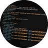</a>
<a href="https://github.com/yeasir19" title="yeasir19"></a>
<a href="https://github.com/yosbelak" title="yosbelak"></a>
<a href="https://github.com/z3129747165-sys" title="z3129747165-sys"></a>
<a href="https://github.com/Zekidt" title="Zekidt"></a>
<a href="https://github.com/Aurora2624" title="Aurora2624"></a>
<a href="https://github.com/cheack" title="cheack"></a>
<a href="https://github.com/williamzerner" title="williamzerner"></a>
<a href="https://github.com/aliabbas9090" title="aliabbas9090"></a>
<a href="https://github.com/Chiku-09" title="Chiku-09"></a>
<a href="https://github.com/dmanikhbd" title="dmanikhbd"></a>
<a href="https://github.com/hmjz100" title="hmjz100"></a>
<a href="https://github.com/karbyt" title="karbyt"></a>
<a href="https://github.com/sentakuhm" title="sentakuhm"></a>
<a href="https://github.com/talison-cardoso" title="talison-cardoso"></a>
<a href="https://github.com/thesomeone115" title="thesomeone115"></a>
<a href="https://github.com/agniveshsp" title="agniveshsp"></a>
<a href="https://github.com/akashraj1988" title="akashraj1988"></a>
<a href="https://github.com/akm-shamiul-islam" title="akm-shamiul-islam"></a>
<a href="https://github.com/alfablac" title="alfablac"></a>
<a href="https://github.com/alifabianda-blip" title="alifabianda-blip"></a>
<a href="https://github.com/AmonR4" title="AmonR4"></a>
<a href="https://github.com/arielfikru" title="arielfikru"></a>
<a href="https://github.com/Asef0Gondal" title="Asef0Gondal"></a>
<a href="https://github.com/Ashalone" title="Ashalone"></a>
<a href="https://github.com/avinash-92" title="avinash-92"></a>
<a href="https://github.com/bojogon7" title="bojogon7"></a>
<a href="https://github.com/CesarChris710" title="CesarChris710"></a>
<a href="https://github.com/Chathu07" title="Chathu07"></a>
<a href="https://github.com/fizzyfrys" title="fizzyfrys"></a>
<a href="https://github.com/fredystar200" title="fredystar200"></a>
<a href="https://github.com/FryLtz" title="FryLtz"></a>
<a href="https://github.com/ginorb" title="ginorb"></a>
<a href="https://github.com/haitham506" title="haitham506"></a>
<a href="https://github.com/heyxferdi" title="heyxferdi"></a>
<a href="https://github.com/iconcomputertgr" title="iconcomputertgr"></a>
<a href="https://github.com/IIIPeAceIII" title="IIIPeAceIII"></a>
<a href="https://github.com/introvert47" title="introvert47"></a>
<a href="https://github.com/isirax" title="isirax"></a>
<a href="https://github.com/Jeff-xxx" title="Jeff-xxx"></a>
<a href="https://github.com/k3r3hor3" title="k3r3hor3"></a>
<a href="https://github.com/kalix123" title="kalix123"></a>
<a href="https://github.com/kartikbillimoria" title="kartikbillimoria"></a>
<a href="https://github.com/klishey" title="klishey"></a>
<a href="https://github.com/KodeBarista" title="KodeBarista"></a>
<a href="https://github.com/lostb053" title="lostb053"></a>
<a href="https://github.com/MBSCODER" title="MBSCODER"></a>
<a href="https://github.com/Mertsudo" title="Mertsudo"></a>
<a href="https://github.com/mesbaulislam" title="mesbaulislam"></a>
<a href="https://github.com/mohachi" title="mohachi"></a>
<a href="https://github.com/MrxSiN" title="MrxSiN"></a>
<a href="https://github.com/muhammadiftikarmaureza" title="muhammadiftikarmaureza"></a>
<a href="https://github.com/nasrrafiq" title="nasrrafiq"></a>
<a href="https://github.com/nikunj17panchal" title="nikunj17panchal"></a>
<a href="https://github.com/nokubuku" title="nokubuku"></a>
<a href="https://github.com/ozgurkazancci" title="ozgurkazancci">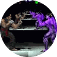</a>
<a href="https://github.com/Pacio" title="Pacio"></a>
<a href="https://github.com/phajiyev" title="phajiyev"></a>
<a href="https://github.com/phamducthanh0321-debug" title="phamducthanh0321-debug"></a>
<a href="https://github.com/pula-web" title="pula-web"></a>
<a href="https://github.com/rabbit-lunatic" title="rabbit-lunatic"></a>
<a href="https://github.com/Rokun22" title="Rokun22"></a>
<a href="https://github.com/s0ulreap3r" title="s0ulreap3r"></a>
<a href="https://github.com/Supriyadi-ID" title="Supriyadi-ID"></a>
<a href="https://github.com/thugdang" title="thugdang"></a>
<a href="https://github.com/TieruYT" title="TieruYT"></a>
<a href="https://github.com/tinypasaway00" title="tinypasaway00"></a>
<a href="https://github.com/W5a6eeb" title="W5a6eeb"></a>
<a href="https://github.com/yeasin2002" title="yeasin2002"></a>
<a href="https://github.com/yflum" title="yflum"></a>
</p>
<!-- contributors:end -->

## ⭐ Star history

If MDM saves you time, a star is the quickest way to say so, and it helps the next person find
a free download manager. [Star it on GitHub](https://github.com/anefzaoui/misterdownloadmanager/stargazers).

<a href="https://star-history.com/#anefzaoui/misterdownloadmanager&Date">
  <picture>
    <source media="(prefers-color-scheme: dark)" srcset="https://api.star-history.com/svg?repos=anefzaoui/misterdownloadmanager&type=Date&theme=dark">
    
  </picture>
</a>

## Support MDM

MDM is free and always will be. If it saves you time, you can support its creator on
[GitHub Sponsors](https://github.com/sponsors/anefzaoui). It's optional: nothing in the app
changes or unlocks, and there is no paid edition.

## Licence and credits

Copyright (c) 2026 Ahmed Nefzaoui. Mister Download Manager is free software under the
[GNU General Public License, version 3](LICENSE) or (at your option) any later version.

Built on [egui](https://github.com/emilk/egui) through
[storytold's forks](https://github.com/storytold/egui) and
[storytold/craft-libs](https://github.com/storytold/craft-libs) (MIT OR Apache-2.0),
[librqbit](https://github.com/ikatson/rqbit) (Apache-2.0),
[zip](https://github.com/zip-rs/zip2) (MIT), and [yt-dlp](https://github.com/yt-dlp/yt-dlp)
(Unlicense, run as a separate program; as are 7-Zip for 7z and RAR archives, and
[HatchZip](https://github.com/xevrion/hatchzip) (MIT OR Apache-2.0) when installed). Flags from
[flag-icons](https://github.com/lipis/flag-icons) (MIT); pictures drawn with
[rough.js](https://roughjs.com/) (MIT) in [Patrick Hand](https://fonts.google.com/specimen/Patrick+Hand)
(SIL OFL) and [Vega-Lite](https://vega.github.io/vega-lite/) (BSD-3). Bundled icons and artwork
keep their own licences, listed in [ATTRIBUTION.md](ATTRIBUTION.md).
